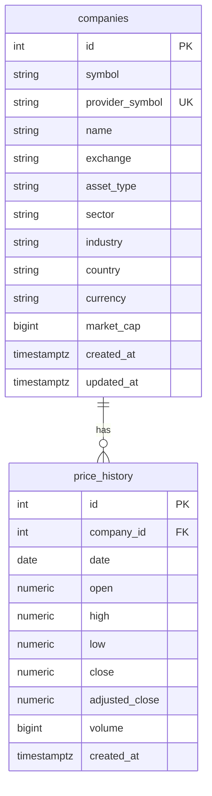

# Database design

Phase 2 covers the market data core. User, portfolio and analysis tables arrive in later phases.

## ERD

## Decisions

- symbol is the display symbol (NPN). provider_symbol is what the data source expects (NPN.JO), so the provider can change without renaming companies.
- Indices live in companies with asset_type "index", so they share the price pipeline.
- currency is stored per company (ZAR or USD). Returns are computed per instrument in its own currency.
- Unique (symbol, exchange) on companies and unique (company_id, date) on price_history. The second also acts as the lookup index.
- Check constraints guard against bad data: positive close, non negative volume, high not below low.
- Prices use Numeric(18, 6) rather than floats, to avoid rounding drift in storage.

## Workflow

    cd backend
    alembic revision --autogenerate -m "create companies and price history"
    alembic upgrade head
    python -m app.scripts.seed
